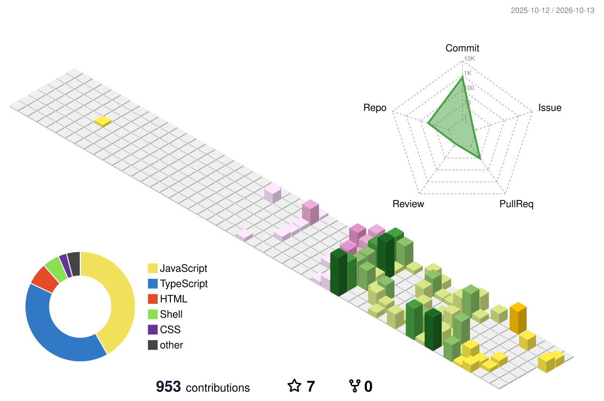

<h1 align="center">Rutuja Darade</h1>

  Full-Stack Developer • Frontend • AI Enthusiast • Open Source • Learning in Public

### About

**I'm a Full-Stack Developer passionate about building modern web applications and creating clean, user-friendly experiences. I enjoy working across both frontend and backend while continuously exploring AI-powered applications and modern web technologies. I love learning by building real-world projects, contributing to open source, collaborating with developers, and constantly improving my skills as a software engineer.**

---

  

  

### Skills

| Category | Technologies |
|-----------|-------------|
| **Frontend** | React, Next.js, JavaScript, TypeScript, HTML5, CSS3, Tailwind CSS |
| **Backend** | Node.js, Express.js, REST APIs |
| **Databases** | PostgreSQL, MongoDB, Supabase, SQL |
| **Devops**| Docker, CI/CD, Jenkins, Github Actions, Nginx, Yaml |
| **AI & Modern Web** | OpenAI APIs, AI-assisted Development, Prompt Engineering |
| **Programming Languages** | JavaScript, TypeScript, C++, SQL |
| **Tools & Version Control** | Git, GitHub, VS Code, Postman, Figma |
| **Core CS Concepts** | Data Structures & Algorithms, Problem Solving, REST APIs |
| **Open Source** | GitHub Collaboration, Open Source Contributions |

---

### Contact

  
  &nbsp;&nbsp;&nbsp;&nbsp;
  
  &nbsp;&nbsp;&nbsp;&nbsp;
  
  &nbsp;&nbsp;&nbsp;&nbsp;
  

  <a href="mailto:rutujadarade2005@gmail.com">Email</a>
  &nbsp;•&nbsp;
  <a href="https://www.linkedin.com/in/rutuja-darade-a53ab3311">LinkedIn</a>
  &nbsp;•&nbsp;
  <a href="https://github.com/rutuja2005byte">GitHub</a>
  &nbsp;•&nbsp;
  <a href="https://rutujadarade.vercel.app">Portfolio</a>

